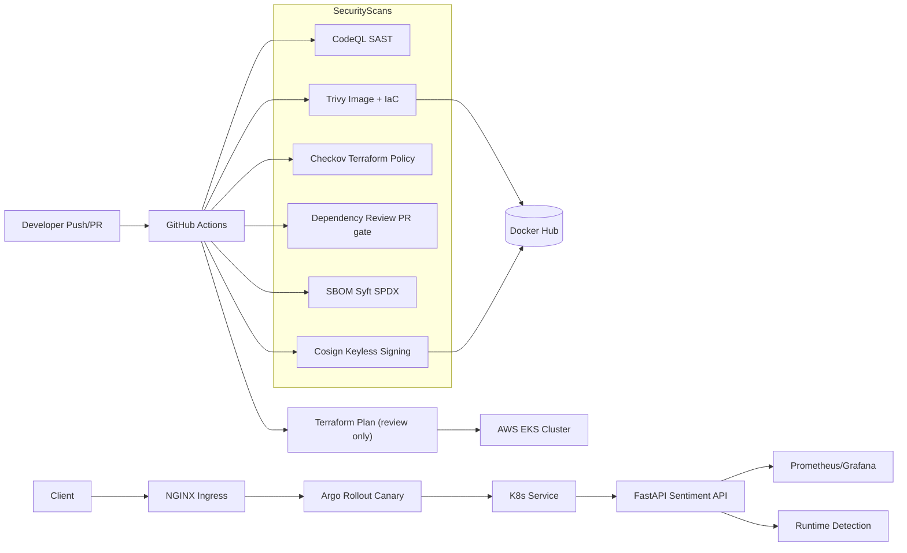

# Secure CI/CD Pipeline for an ML Sentiment Analysis API — DevSecMLOps

This repository demonstrates a secure CI/CD pipeline for a FastAPI-based ML service using VADER sentiment analysis for lightweight inference.

Built  as a hands-on DevSecMLOps project showcasing modern cloud-native security practices end-to-end.


---

## Security Integrations

- SAST → CodeQL
- SCA → Trivy (Docker image & Terraform IaC)
- Policy-as-Code → Checkov
- SBOM → Syft SPDX JSON
- Supply Chain Security → Cosign (keyless signing, OIDC)
- Runtime Security → Falco
- Observability → Prometheus & Grafana
- Deployment → Argo Rollouts with Canary strategy + signature verification

---

## What This Project Does

A secure, production-grade FastAPI sentiment analysis API that:

- Accepts text input and returns `POSITIVE`, `NEGATIVE`, or `NEUTRAL` sentiment labels
- Uses VADER (Valence Aware Dictionary and sEntiment Reasoner) for lightweight, CPU-friendly inference — no GPU or heavy ML frameworks required
- Is secured end-to-end: from code commit to container signing to Kubernetes deployment

---

## Architecture



---

## Security Governance

| Layer | Tool | Purpose |
|---|---|---|
| SAST | CodeQL | Static code analysis, SARIF uploaded to GitHub Security tab |
| SCA | Trivy | Docker image & Terraform IaC vulnerability scanning |
| Policy-as-Code | Checkov | Terraform best-practice enforcement |
| SBOM | Syft | SPDX JSON supply chain artifact generation |
| Supply Chain | Cosign | Keyless container image signing via GitHub OIDC |
| Runtime | Falco | Syscall-based intrusion detection |
| Observability | Prometheus + Grafana | Metrics, dashboards, alerting |
| Deployment | Argo Rollouts | Canary delivery with signed image verification |
| Identity & Access | GitHub OIDC | Federated AWS IAM — no static keys |

---

## Tech Stack

| Category | Technology |
|---|---|
| API | Python 3.11, FastAPI, VADER sentiment analysis |
| Containers | Docker (multi-stage, slim, non-root, read-only FS) |
| CI/CD | GitHub Actions, least-privilege job tokens |
| Security Tools | CodeQL, Trivy, Checkov, Cosign, Falco, Syft SBOM |
| Cloud Infra | AWS EKS, private subnets, VPC, KMS encryption (Terraform) |
| Observability | Prometheus, Grafana, ServiceMonitor |
| Auth | JWT bearer tokens (short-lived), GitHub OIDC for AWS |

---

## Local Development

Build and run locally:


Get a token first (demo user):

```bash
curl -sS -X POST http://localhost:8000/token \
  -d 'username=demo&password=demo123!' \
  -H 'Content-Type: application/x-www-form-urlencoded'
```

Call the sentiment prediction endpoint:

```bash
curl -sS -X POST http://localhost:8000/predict \
  -H 'Content-Type: application/json' \
  -H 'Authorization: Bearer <jwt>' \
  -d '{"text":"I love building secure cloud applications!"}'
```

Swagger UI:
```
http://localhost:8000/docs
```

Health check:
```
http://localhost:8000/healthz
```

---

## GitHub Actions Workflows

| Workflow | Trigger | Purpose |
|---|---|---|
| `devsecops.yml` | Push to `main` / PR | SAST, Trivy, Checkov, SBOM, Terraform plan |
| `publish-and-sign.yml` | Push to `main` (app changes) | Build, Push, SBOM, Cosign sign |
| `cd-rollout.yml` | After publish succeeds | Verify signature, Deploy Argo Rollout |
| `deploy-eks-addons.yml` | Manual dispatch | Deploy Prometheus, Grafana, Falco |
| `dependency-review.yml` | Pull Request | Block PRs with HIGH/CRITICAL dependencies |

---

## GitHub Secrets Required

```
DOCKERHUB_USERNAME     -> thriniiiiiiiiiiii
DOCKERHUB_TOKEN        -> Your Docker Hub access token
JWT_SECRET             -> Your chosen JWT signing secret
AWS_RO_ROLE_ARN        -> IAM role ARN for read-only Terraform plan
AWS_EKS_ROLE_ARN       -> IAM role ARN for EKS deployment
GRAFANA_ADMIN_PASS     -> Grafana admin password (for monitoring stack)
```

AWS keys are not stored in GitHub. GitHub Actions uses OIDC federation to assume short-lived AWS IAM roles — no long-lived secrets.

---

## Terraform (AWS EKS Infrastructure)

```bash
cd terraform-eks
terraform init
terraform plan
terraform apply   # Provisions VPC, private EKS cluster with KMS encryption
```

What gets provisioned:
- VPC with public + private subnets across 2 AZs
- NAT Gateway for private subnet egress
- EKS cluster (v1.29) with private endpoints only
- KMS encryption for Kubernetes secrets
- IAM roles for cluster & node groups (least-privilege)
- All EKS control plane logs enabled

---

## Observability & Runtime Security

- Prometheus & Grafana → Real-time metrics and dashboards (deploy via `deploy-eks-addons.yml`)
- Falco → Detects suspicious syscalls (reverse shells, crypto mining, privilege escalation)
- ServiceMonitor → Automatically scrapes app `/metrics` endpoint

---

## Threat Model

A detailed threat model for this project (STRIDE methodology + OWASP Top 10 alignment) is documented in [ThreatModel.md]\
---

## Future Improvements

- Secrets Management: Integrate HashiCorp Vault or AWS Secrets Manager
- Admission Control: Kyverno / OPA to enforce signed images at admission
- E2E Testing: Extend CI/CD with pytest integration tests
- Multi-region: DR setup across AWS regions

---

## Notes

- AWS authentication is handled via GitHub OIDC — no static IAM keys exist in GitHub.
- Forked repositories cannot access AWS roles/secrets.
- The pipeline is cost-conscious: rollout steps soft-skip if no EKS cluster is found.
- Docker image: `thriniiiiiiiiiiii/secure-ml-sentiment-api:latest`
